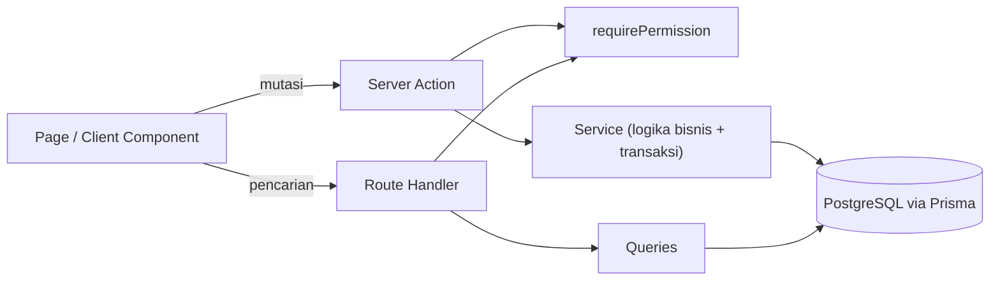
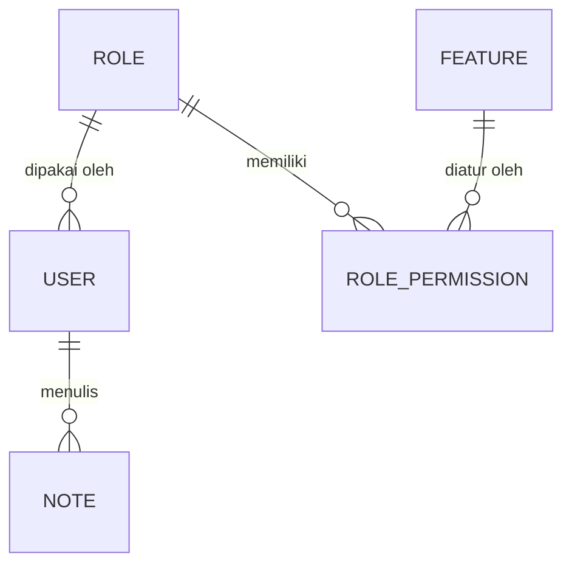

# User Role Management

Aplikasi manajemen user, role, dan hak akses (RBAC) berbasis **Next.js full stack**.
Dibuat sebagai proyek belajar dan portfolio, dengan fokus pada **validasi izin di sisi server**,
bukan hanya di tampilan.

<!-- Tambahkan 2-3 screenshot: login, matriks izin, tabel user -->
<!--  -->

## Fitur

- Registrasi dan login (JWT di cookie `httpOnly`)
- Manajemen **Feature**, **Role**, **Role Permission** (matriks izin), dan **User**
- Izin per aksi: `read`, `add`, `edit`, `delete`, diatur per role dan per feature
- Izin dicek di **page, Server Action, dan Route Handler**, bukan hanya menyembunyikan tombol
- Cascade otomatis: feature baru memberi baris izin ke semua role, role baru ke semua feature
- Modul **Note** (milik tiap user) sebagai alat uji permission dan kepemilikan data
- Pencarian dan paginasi (Server Component pada Feature/Role, TanStack Query pada Note/User)
- Pembatasan percobaan login, proteksi Super Admin, dan header keamanan

## Tech stack

Next.js (App Router) · TypeScript · Tailwind CSS · Prisma 7 · PostgreSQL · Server Actions · Zod ·
jose (JWT) · bcryptjs · TanStack Query · SweetAlert2 · React Context

## Arsitektur



Setiap modul (`src/modules/<nama>`) punya pola yang sama:
`schema (Zod) → queries → service → actions → components`.
Service tidak mengimpor apa pun dari Next.js sehingga logika bisnisnya bisa dipanggil dari mana saja.



## Keputusan keamanan

| Keputusan                                                             | Alasan                                                       |
| --------------------------------------------------------------------- | ------------------------------------------------------------ |
| Session hanya berisi `userId`, izin dibaca dari DB tiap request       | Perubahan role langsung berlaku                              |
| Izin = flag role **dan** aksi masih ada di `availableActions` feature | Mencabut aksi dari feature otomatis mencabut akses           |
| Tanpa baris izin berarti ditolak (default deny)                       | Aman bila data tidak lengkap                                 |
| Kepemilikan note dicek dalam satu query (`updateMany`/`deleteMany`)   | Tidak ada celah antara cek dan ubah                          |
| Super Admin terakhir tidak bisa dihapus atau diturunkan               | Mencegah sistem terkunci                                     |
| Hanya Super Admin yang boleh memberi role Super Admin                 | Mencegah eskalasi hak akses                                  |
| Primary key UUID v7                                                   | ID sulit ditebak, tetap berurutan waktu untuk performa index |
| Hash password tidak pernah di-`select`                                | Tidak bisa bocor lewat query atau API                        |
| Login dibatasi 5 gagal per email dan 20 per IP dalam 15 menit         | Mempersulit tebak password                                   |

## Menjalankan secara lokal

Prasyarat: Node.js LTS dan PostgreSQL 16+ (misalnya lewat Laragon).

```bash
git clone <url-repo>
cd user-role-management
npm install
cp .env.example .env        # lalu isi DATABASE_URL dan SESSION_SECRET
npm run db:migrate          # membuat tabel
npm run db:seed             # role, feature, izin, dan akun Super Admin
npm run dev
```

Akun demo hasil seeder (**khusus lokal**, ganti lewat `SEED_ADMIN_EMAIL` dan `SEED_ADMIN_PASSWORD`):
`superadmin@mail.com` / `superadmin#123`

| Script                        | Fungsi                              |
| ----------------------------- | ----------------------------------- |
| `npm run dev`                 | Server pengembangan                 |
| `npm run build` / `npm start` | Build dan jalankan produksi         |
| `npm run db:migrate`          | Migrasi (pengembangan)              |
| `npm run db:seed`             | Seeder (idempotent, aman diulang)   |
| `npm run db:studio`           | Prisma Studio                       |
| `npm run db:reset`            | Hapus semua data lalu migrasi ulang |

## Pengembangan lanjutan

- Pencabutan sesi saat password diganti (`passwordChangedAt`)
- Audit log perubahan izin
- Pembatasan pendaftaran dan Content-Security-Policy
- Pengujian otomatis (Vitest untuk service, Playwright untuk alur utama)
